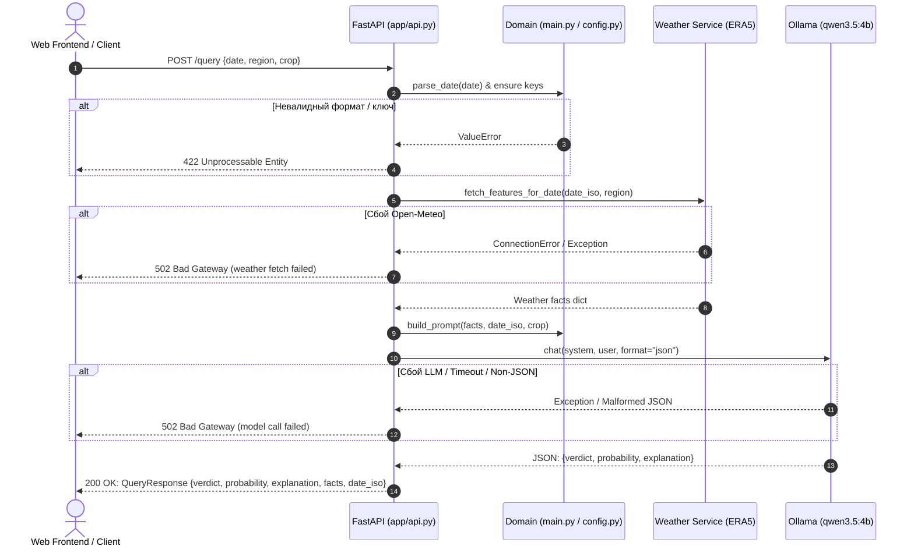

# Спецификация: HTTP API поверх существующего CLI (Команда Logic)

## 1. Цель и контекст
- **Цель:** Предоставить легковесный, строго типизированный HTTP API для обслуживания веб-клиента и интеграций, сохранив существующую архитектуру CLI и доменную логику без деградации.
- **SDD Framework:** Разработано и зафиксировано через инструмент `git-spec` (парсинг зависимостей, векторная индексация, верификация спецификаций).
- **Связанный контракт:** [specs/contract.md](file:///home/hackerman/Documents/education/itmo/vibecoding/ITMOv2/practices/practice_05/specs/contract.md).

## 2. Архитектурные ограничения
- Доменные модули (`app/weather.py`, `app/ollama_client.py`, `app/config.py`, `main.py`) не модифицируются в части бизнес-логики.
- API-слой реализован в `app/api.py` через фабрику `create_app()` на базе FastAPI.
- Валидация входных данных осуществляется через Pydantic v2 и доменные функции `parse_date`, `ensure_region_key`, `ensure_crop_key`.
- Поддержка CORS Middleware для любых клиентов.
- Автоматическая раздача статических файлов фронтенда из директории `web/` (`/` -> `index.html`, `/static/...`).

## 3. Спецификация эндпоинтов

### 3.1. `GET /health`
- **Назначение:** Healthcheck для балансировщиков, клиентских индикаторов и систем мониторинга.
- **Вход:** Нет.
- **Выход:** `200 OK` с телом `{"status": "ok", "ok": true}`.

### 3.2. `POST /query`
- **Назначение:** Полный пайплайн анализа даты посадки.
- **Входная схема (`QueryRequest`):**
  - `date: str` (обязательное) — дата в формате `dd-mm-yyyy`.
  - `region: str` (по умолчанию `"spb"`) — ключ региона (`spb`, `moscow`).
  - `crop: str` (по умолчанию `"tomato"`) — ключ культуры (`tomato`, `potato`, `cucumber`).
  - `model: Optional[str]` (по умолчанию `"qwen3.5:4b"`) — модель Ollama.
  - `temperature: Optional[float]` (по умолчанию `0.2`) — температура сэмплинга.
- **Выходная схема (`QueryResponse`):**
  - `verdict: Optional[str]` — решение модели.
  - `probability: Optional[float]` — вероятность успеха (0.0 – 100.0).
  - `explanation: Optional[str]` — текстовое объяснение.
  - `facts: Dict[str, Any]` — агрегированные погодные факты ERA5.
  - `date_iso: str` — дата в формате `YYYY-MM-DD`.

### 3.3. Обработка ошибок
- **422 Unprocessable Entity:**
  - Дата не соответствует маске `dd-mm-yyyy` или содержит несуществующий день/месяц.
  - Указан неизвестный регион (не входит в `REGIONS`).
  - Указана неизвестная культура (не входит в `CROPS`).
- **502 Bad Gateway:**
  - Сбой сетевого запроса к архивному API Open-Meteo ERA5.
  - Недоступность локального демона Ollama (`127.0.0.1:11434`) или таймаут инференса (>90 с).
  - Модель вернула невалидный JSON, нарушив контракт structured output.

## 4. Схема потока обработки запроса

## 5. Критерии приёмки (Acceptance Criteria)
1. **AC-API-1:** Все 3 культуры (`tomato`, `potato`, `cucumber`) и 2 региона (`spb`, `moscow`) успешно обрабатываются и возвращают `QueryResponse`.
2. **AC-API-2:** Некорректные форматы дат (`2026/05/15`, `32-01-2024`, пустая строка) отсекаются с кодом 422 до вызова внешних сервисов.
3. **AC-API-3:** Неизвестный регион/культура отсекаются с кодом 422 до вызова модели.
4. **AC-API-4:** Ошибки сети Open-Meteo и сбои LLM транслируются в понятный код 502.
5. **AC-API-5:** Доступность эндпоинта `/health` подтверждается статусом `200` с полями `status: "ok"` и `ok: true`.
6. **AC-API-6:** Локальный запуск сервера через uvicorn корректно поднимается и отвечает на запросы.
