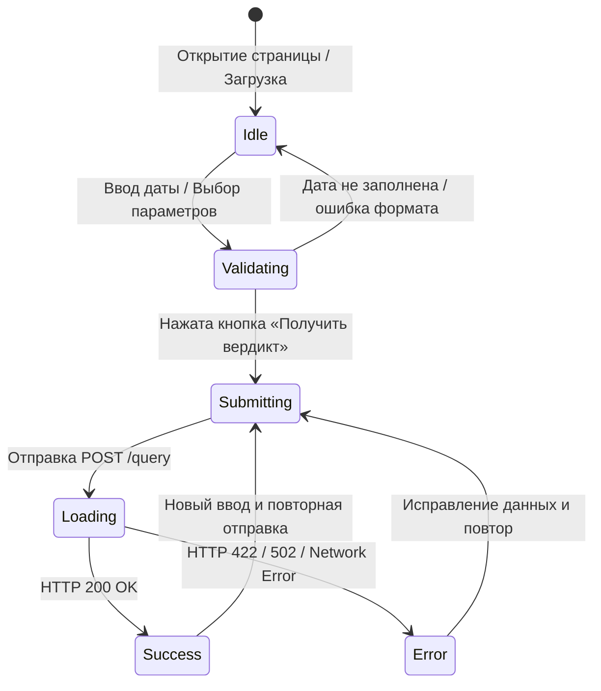

# Общий контракт взаимодействия (API & Frontend)

Документ фиксирует согласованный контракт между Командой UI (фронтенд) и Командой Logic (бэкенд/API) для фичи «Веб-интерфейс оценки благоприятности посадки культур».

Контракт согласован до начала реализации кода и обязателен для обеих сторон.

---

## 1. Общие принципы и протокол

- **Протокол:** HTTP/1.1 (JSON over HTTP) + раздача статики.
- **Базовый URL:** `http://127.0.0.1:8000` (локальный запуск) или относительные пути (`/query`, `/health`, `/static/...`).
- **Формат данных:** `application/json; charset=utf-8`.
- **CORS:** Включён (`Access-Control-Allow-Origin: *`) для поддержки независимого запуска клиента при необходимости.
- **Статические файлы:** Раздаются FastAPI по пути `/static/` (`index.html`, `app.js`, `styles.css`), корневой URL `/` возвращает `index.html`.

---

## 2. Эндпоинты

### 2.1. `GET /health`
Проверка работоспособности сервиса.

- **Запрос:** без параметров и тела.
- **Ответ 200 OK:**
  ```json
  {
    "status": "ok",
    "ok": true
  }
  ```

---

### 2.2. `POST /query`
Основной метод расчёта благоприятности посадки по погодным факторам ERA5 и локальной LLM.

#### Тело запроса (Request Payload)
```json
{
  "date": "15-05-2026",
  "region": "spb",
  "crop": "tomato",
  "model": "qwen3.5:4b",
  "temperature": 0.2
}
```

| Поле | Тип | Обязательное | Значение по умолчанию | Описание и ограничения |
|---|---|---|---|---|
| `date` | `string` | **Да** | — | Дата посадки строго в формате `dd-mm-yyyy` (например, `15-05-2026`). День `01-31`, месяц `01-12`. |
| `region` | `string` | Нет | `"spb"` | Ключ региона из реестра: `"spb"`, `"moscow"`. |
| `crop` | `string` | Нет | `"tomato"` | Ключ культуры: `"tomato"`, `"potato"`, `"cucumber"`. |
| `model` | `string` | Нет | `"qwen3.5:4b"` | Имя модели Ollama для инференса. |
| `temperature` | `number` | Нет | `0.2` | Температура генерации (диапазон `0.0` – `2.0`). |

#### Успешный ответ (Response 200 OK)
```json
{
  "verdict": "Благоприятно",
  "probability": 85.0,
  "explanation": "Температурный режим (мин 8°C, макс 18.5°C) и достаточная инсоляция обеспечивают оптимальные условия для высадки томатов.",
  "facts": {
    "location": {
      "city": "Санкт-Петербург",
      "lat": 59.9386,
      "lon": 30.3141
    },
    "date": "2026-05-15",
    "daily": {
      "temperature_max": 18.5,
      "temperature_min": 8.0,
      "precipitation_sum": 0.0,
      "sunshine_hours": 9,
      "wind_speed_max": 4.2
    },
    "hourly": {
      "temperature_2m_avg": 13.5,
      "temperature_2m_max": 18.5,
      "temperature_2m_min": 8.0,
      "cloudcover_avg": 35.0,
      "precipitation_sum": 0.0,
      "sunshine_hours": 9,
      "daily_windspeed_max": 4.2
    },
    "data_source": "open-meteo.com ERA5",
    "region_key": "spb",
    "timezone": "Europe/Moscow"
  },
  "date_iso": "2026-05-15"
}
```

| Поле ответа | Тип | Описание |
|---|---|---|
| `verdict` | `string` \| `null` | Текстовый вердикт модели (например, `"Благоприятно"`, `"Неблагоприятно"`). |
| `probability` | `number` \| `null` | Числовая оценка вероятности успеха (0 – 100). |
| `explanation` | `string` \| `null` | Краткое обоснование агронома (2–4 предложения). |
| `facts` | `object` | Структура с собранными погодными фактами ERA5. |
| `date_iso` | `string` | Нормализованная дата в ISO формате `YYYY-MM-DD`. |

---

## 3. Таблица ошибок и кодов состояний

| Код | Причина | Формат ответа | Действие фронтенда |
|---|---|---|---|
| **422 Unprocessable Entity** | Неверный формат даты, несуществующий регион или культура | `{"detail": "..."}` | Отобразить пользователю предупреждение под полем или в alert-баннере с текстом ошибки |
| **502 Bad Gateway** | Ошибка внешнего сервиса (Open-Meteo недоступен или Ollama не отвечает / вернула некорректный не-JSON ответ) | `{"detail": "weather fetch failed: ..."}` или `{"detail": "model call failed: ..."}` | Показать уведомление о временной недоступности бэкенд-сервисов и предложить повторить попытку |
| **500 Internal Server Error** | Непредвиденное исключение в коде API | `{"detail": "Internal server error"}` | Показать системную ошибку в баннере |

---

## 4. Состояния пользовательского интерфейса (State Machine)



1. **Idle (Начальное):**
   - Форма активна, кнопка отправки доступна.
   - Поля результата скрыты.
   - Фоновая проверка `/health` обновляет индикатор онлайна API.
2. **Loading (Загрузка):**
   - Кнопка заблокирована (`disabled`), вращается спиннер.
   - Текст кнопки: `Анализ погодных данных и LLM...`.
   - Предыдущие ошибки скрыты.
3. **Success (Успех):**
   - Блок результата отображается: крупный вердикт, цветной индикатор (зеленый/красный), процентная шкала вероятности (0–100%), блок с фактами погоды и метаинформацией.
4. **Error (Ошибка):**
   - Отображается Alert-баннер с расшифровкой причины (422 — валидация, 502 — сбой сети/модели).
   - Кнопка разблокирована для повторного запроса.

---

## 5. Допустимые значения параметров (Enums)

### Регионы (`region`):
- `spb`: Санкт-Петербург (59.9386, 30.3141, Europe/Moscow)
- `moscow`: Москва (55.7558, 37.6173, Europe/Moscow)

### Культуры (`crop`):
- `tomato`: Томаты (требуют ночной температуры > 10°C, солнца > 6 ч)
- `potato`: Картофель (допускает посадку при температуре почвы > 7°C)
- `cucumber`: Огурцы (теплолюбивые, критична температура > 14°C)
