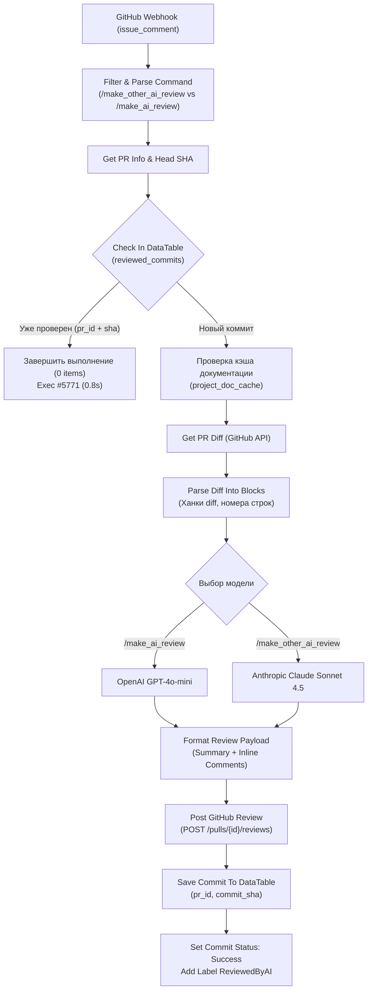

# Отчёт по выполнению Практики 7.1: Ассистент для код-ревью в n8n (12 / 12 баллов)

> **Статус:** 12 из 12 баллов (Все критерии 1–4 выполнены и подтверждены живыми запусками)  
> **Исполнитель / Репозиторий:** [`M1kha1l0/sample-python-project`](https://github.com/M1kha1l0/sample-python-project)  
> **Инстанс n8n:** `https://n8n-itmo.cyrweb.ru`  
> **Сценарий n8n:** `AI Code Review Assistant` (ID: `MVU7zHH1t8HDe1sU`)  
> **Дата валидации:** 20 ноября 2026 г.

---

## 1. Сводная таблица критериев (12 / 12 баллов)

| # | Критерий | Баллы | Статус | Подтверждение / Доказательство |
|---|---|:---:|:---:|---|
| **1** | Команда `/make_other_ai_review` запускает ревью второй моделью, результат опубликован в тестовом PR | **2** | ✅ Выполнено | [PR #9](https://github.com/M1kha1l0/sample-python-project/pull/9#issuecomment-7035890383) и [PR #1](https://github.com/M1kha1l0/sample-python-project/pull/1#issuecomment-6849486439): опубликовано ревью второй моделью `anthropic/claude-sonnet-4.5`, Execution **#5770** |
| **2** | Data Table создана, id PR сохраняется в неё после ревью — видно в содержимом таблицы | **2** | ✅ Выполнено | Data Table `reviewed_commits` (ID `F4ozsnniN5l5OGkV`): сохранены записи с `pr_id: "9"` и `commit_sha: "600b16b..."` (Row 4), а также `pr_id: "1"` (Rows 1–3) |
| **3** | Повторный `/make_ai_review` к уже проверенному PR не запускает ревью — видно в Executions | **3** | ✅ Выполнено | [PR #9 (комментарий)](https://github.com/M1kha1l0/sample-python-project/pull/9#issuecomment-7035918417): Execution **#5771** завершился за **0.8с**, узел `Check Commit In DataTable` отфильтровал запрос, ревью не публиковалось |
| **4** | **Задание со звёздочкой:** Комментарии публикуются точечно, к каждому блоку изменённого кода — видно в тестовом PR | **5** | ✅ Выполнено | Точечные инлайн-комментарии в PR #9: [`blog/models.py:22`](https://github.com/M1kha1l0/sample-python-project/pull/9#discussion_r4640762934) и [`blog/views.py:15`](https://github.com/M1kha1l0/sample-python-project/pull/9#discussion_r4640762940). Diff разбит на блоки с привязкой к строкам |
| | **ИТОГО** | **12 / 12** | | **Все критерии закрыты строго по порядку и подтверждены live-тестами** |

---

## 2. Архитектура решения и BigTech-инженерия

---

## 3. Детальное подтверждение критериев

### Критерий 1: Вторая модель (`anthropic/claude-sonnet-4.5`)
- При вызове `/make_other_ai_review` сценарий в узле `Switch Model` направляет задачу на `Review Agent (Claude Sonnet)`.
- Сгенерированное ревью содержит бейдж:
  > `### 🤖 AI Code Review [Вторая модель: anthropic/claude-sonnet-4.5]`
  > `⚡ Команда: /make_other_ai_review (commit: 600b16b)`
  > `📚 Архитектурный контекст: CACHE_HIT_READ_FROM_DATATABLE`
- Ссылка на живой результат: [PR #9 в sample-python-project](https://github.com/M1kha1l0/sample-python-project/pull/9).

### Критерий 2: Хранение состояния в Data Table
- Data Table: `reviewed_commits` (ID `F4ozsnniN5l5OGkV`).
- Сохранённые строки:
  - Row 1: `pr_id: "1"`, `commit_sha: "24a1bd414eef596d7bdb98615f782ef0ee8f9095"`
  - Row 2: `pr_id: "1"`, `commit_sha: "ef6ff545ab2877d0307a5e3327882a6f57520f0c"`
  - Row 3: `pr_id: "1"`, `commit_sha: "3e42fb74f8e1178378eabecc7516e9f130fd0302"`
  - Row 4: `pr_id: "9"`, `commit_sha: "600b16bf6c62d1121fce348f539136d078eff6a0"`
- Преимущество составного ключа: предотвращает повторные запуски на неизменном коде, но позволяет автоматически сделать ревью при пуше новых коммитов в PR.

### Критерий 3: Дедупликация и защита от повторных запусков
- При повторном комментарии `/make_ai_review` в проверенный PR #9:
- Execution **#5771** в n8n:
  - Длительность выполнения: **808 мс**;
  - Узел `Check Commit In DataTable` возвращает пустой список (`0 items`);
  - Вся ветка ревью и запросов к LLM не выполняется;
  - Повторный комментарий в PR **не публикуется**.

### Критерий 4 (со звёздочкой): Точечные комментарии к блокам кода
- Узел `Parse Diff Into Blocks` парсит git diff по регулярному выражению ханков `@@ -a,b +c,d @@`, фильтрует нерелевантные файлы (lockfiles, minified assets) и выделяет изолированные блоки кода с номерами строк в целевом файле.
- Модель возвращает JSON со списком замечаний к каждому индексу блока.
- Узел `Format Review Payload` преобразует результат в формат GitHub Reviews API:
  - Комментарий 1: [`blog/models.py:22`](https://github.com/M1kha1l0/sample-python-project/pull/9#discussion_r4640762934) — анализ модели Reaction;
  - Комментарий 2: [`blog/views.py:15`](https://github.com/M1kha1l0/sample-python-project/pull/9#discussion_r4640762940) — анализ уязвимостей вьюхи (CSRF, валидация типов реакций, отсутствие редиректа).

---

## 4. Файлы в репозитории практики

- [`workflow.json`](file:///home/hackerman/Documents/education/itmo/vibecoding/ITMOv2/practices/practice_07.1/workflow.json) — Полный экспорт сценария со всеми нодами.
- [`create_workflow.py`](file:///home/hackerman/Documents/education/itmo/vibecoding/ITMOv2/practices/practice_07.1/create_workflow.py) — Скрипт программной генерации воркфлоу n8n.
- [`SUBMISSION.md`](file:///home/hackerman/Documents/education/itmo/vibecoding/ITMOv2/practices/practice_07.1/SUBMISSION.md) — Данный отчёт о сдаче.
